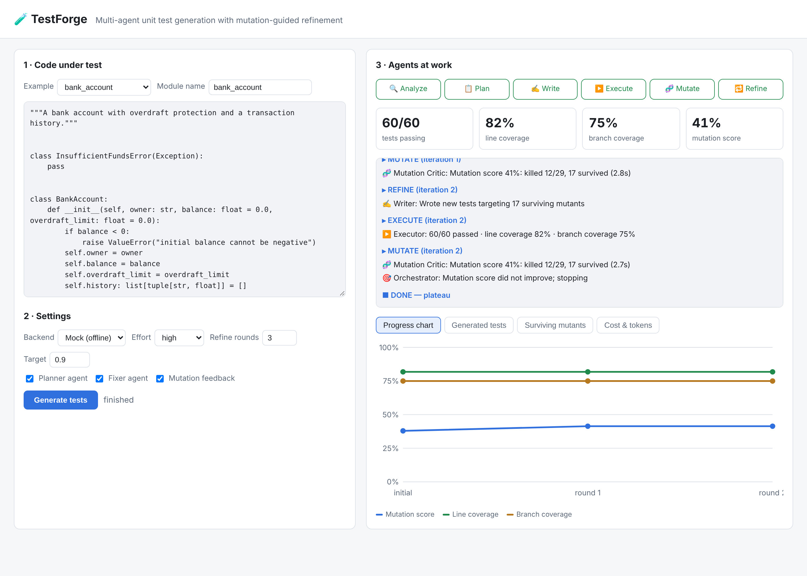
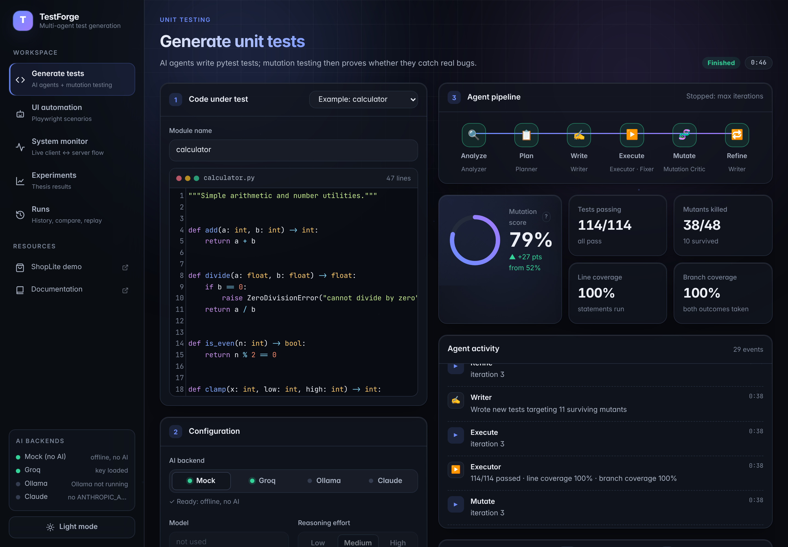

# TestForge

**An Autonomous Multi-Agent Framework for Unit Test Generation with Mutation-Guided Refinement**

TestForge takes a Python module and automatically writes a pytest suite for it.
A team of specialised agents plans, writes, runs and repairs the tests, then a
mutation-testing critic plants small bugs in the code and tells the writer which
ones the tests missed. The loop repeats until the suite is strong enough.



## Dashboard

`testforge serve --open` (or `run_dashboard.bat`) opens a React dashboard at http://127.0.0.1:8080
(another port: `testforge serve --port 9000`, or `run_dashboard.bat 9000`; if the port is busy,
the next free one is used and printed):

| Page | What it shows |
|---|---|
| **Generate tests** | Code editor, backend/agent settings, live agent pipeline, score gauge and KPIs, activity timeline, generated tests, surviving-mutant diffs |
| **UI automation** | Playwright scenarios against ShopLite, bug injection, step-by-step results with screenshots, bug × scenario matrix |
| **System monitor** | Live architecture map (browser → API → orchestrator → AI model / test sandbox / mutation workers / Playwright). Every particle is a real request recorded by `testforge/telemetry.py`, with real latencies, plus an event stream |
| **Experiments** | Thesis results read from `results/*/runs.csv`: per-configuration scores, refinement curves, per-module comparison |
| **Runs** | Every run saved on the server: replay a run exactly as it happened, or compare two runs side by side |



Built with React, TypeScript, Tailwind CSS and Framer Motion (spring physics, shared-layout
transitions, reduced-motion support). The built app is committed in `testforge/web/static/app`,
so running TestForge needs **no Node.js**. To change the frontend:

```bash
cd frontend
npm install
npm run dev      # http://localhost:5173, proxies the API to testforge serve on :8080
npm run build    # writes testforge/web/static/app
```

The previous plain-HTML dashboard is still available at `/classic`.

## How it works

```
                 🎯 Orchestrator
                       │
 🔍 Analyzer → 📋 Planner → ✍️ Writer → ▶️ Executor ⇄ 🔧 Fixer
                              ▲              │
                              │              ▼
                   surviving mutants   🧬 Mutation Critic
                              └──────── score < target?
```

| Agent | Type | Responsibility |
|---|---|---|
| Analyzer | deterministic | AST analysis: functions, parameters, exceptions, branch complexity, boundary constants |
| Planner | LLM | Designs normal / boundary / error / state test cases |
| Writer | LLM | Writes the pytest file; in refinement rounds writes tests that target surviving mutants and flags equivalent mutants |
| Executor | deterministic | Runs pytest in an isolated workspace with line + branch coverage |
| Fixer | LLM | Repairs failing tests (the code under test is the oracle); tests that still fail are pruned |
| Mutation Critic | deterministic | Own AST mutation engine (AOR, ROR, LCR, UOI, CRP, RET, ASR), runs mutants in parallel |
| Orchestrator | control loop | Coordinates agents, stops on target reached / plateau / iteration limit, records metrics |

LLM agents use **structured outputs** (pydantic schemas), so the orchestrator never parses free text.

## Install

**Windows (easiest):**
1. Install Python 3.12+ from https://www.python.org/downloads/ and tick **"Add Python to PATH"**.
2. Download this project (GitHub: **Code → Download ZIP**) and unzip it.
3. Double-click `setup_windows.bat` (one time only).
4. Double-click `run_dashboard.bat`; the dashboard opens in your browser.
5. Optional, for free AI: create a key at https://console.groq.com (API Keys → Create API Key), save it
   alone in a file named `groq_key.txt` in the project folder, restart `run_dashboard.bat` and choose
   **Groq (free tier)** as the backend. `groq_key.txt` is git-ignored, so it is never uploaded.

**macOS / Linux:** `bash setup_unix.sh`

**Manual:**

```bash
pip install -e .
```

## Test your own code with mutations

Hands-on guide: [docs/MANUAL_TESTING.md](docs/MANUAL_TESTING.md) (tutorial files in `examples/tutorial/`).

```bash
testforge mutants mycode.py                    # list every mutant (bug) TestForge plants
testforge mutants mycode.py --show 4           # see mutant 4 as a diff
testforge mutate mycode.py test_mycode.py --all  # score YOUR tests: which mutants they catch
```

## UI test automation

Besides unit tests, TestForge has a **keyword-driven UI automation engine** built on Playwright.
It ships with **ShopLite** (`/demo`), a sample shop with a search box, product buttons, a cart and a
registration form with eight inputs, and 17 scenarios (`testforge/uiauto/scenarios/shoplite.json`)
written as plain steps:

```json
{"action": "fill",  "target": "search-input", "value": "lamp"},
{"action": "click", "target": "search-button"},
{"action": "expect_text", "target": "results-count", "equals": "Showing 1 of 8 products"}
```

ShopLite can be broken on purpose (`/demo?bugs=search,total`, nine bugs available) to check that
the scenarios catch real faults: the UI counterpart of mutation testing.

* Dashboard: open **UI automation** in the top menu: search/select scenarios, tick bugs to inject,
  then **Run selected scenarios** (live results with step details and a screenshot of every
  failure) or **Run bug hunt** (each bug injected in turn; shows which scenarios catch it).
* Command line:

```bash
testforge ui-test                       # run all scenarios against the built-in demo
testforge ui-test --grep cart           # only scenarios whose name/tags contain "cart"
testforge ui-test --bugs search,total   # inject bugs
testforge ui-test --bug-hunt            # detection matrix for all nine bugs
testforge ui-test --headed              # watch the browser
testforge ui-test --url https://your-app.example --scenarios my_scenarios.json
```

First time only: `python -m playwright install chromium` (the Windows setup script does it).

## Run it on the web (free, with Render)

TestForge runs the Python code you give it, so the web version is protected by a password.

1. Sign up at https://render.com (free; "Sign in with GitHub" is easiest).
2. Click **New → Blueprint**, connect GitHub and pick the `testforge` repository.
   Render reads `render.yaml` and sets everything up.
3. When asked for environment variables, enter:
   * `TESTFORGE_PASSWORD`: a password of your choice (required to open the dashboard)
   * `GROQ_API_KEY`: your key from https://console.groq.com (optional, enables free AI)
4. Click **Apply**. After the build (a few minutes) Render shows your URL, e.g.
   `https://testforge-xxxx.onrender.com`. Open it, enter any user name and your password.

On Render's free plan the service sleeps after about 15 minutes without visits; the first visit
after that takes up to a minute to wake it. The same image runs anywhere Docker does:

```bash
docker build -t testforge-web .
docker run -p 8000:8000 -e TESTFORGE_PASSWORD=choose-one -e GROQ_API_KEY=gsk_... testforge-web
```

## Usage

```bash
# Offline mock backend (no API key needed)
testforge generate examples/calculator.py

# With Claude (needs ANTHROPIC_API_KEY)
export ANTHROPIC_API_KEY=...
testforge generate examples/bank_account.py --llm claude

# Ablation study: switch agents off
testforge generate examples/calculator.py --llm claude --no-planner
testforge generate examples/calculator.py --llm claude --no-mutation-feedback

# Mutation-score any existing test suite (e.g. human-written tests, a Pynguin baseline)
testforge mutate examples/calculator.py path/to/test_calculator.py

# Web dashboard at http://127.0.0.1:8080
testforge serve
```

Each `generate` run writes `generated_tests/test_<module>.py` and a JSON report
with per-iteration metrics (tests, coverage, mutation score, tokens, cost, time)
for the evaluation chapter.

## Experiments

```bash
python experiments/run.py                          # offline baseline only
python experiments/run.py --configs all --reps 3   # all configurations (needs ANTHROPIC_API_KEY)
```

| Configuration | Purpose |
|---|---|
| `mock_baseline` | Non-LLM baseline |
| `claude_single_shot` | Plain LLM: one prompt, no planning, repair or feedback |
| `claude_full` | The proposed multi-agent system |
| `claude_no_planner` / `claude_no_fixer` / `claude_no_feedback` | Ablations: full system minus one agent |
| `ollama_*` | The same five configurations on a free local model |

Results go to `results/`: `runs.csv`, `iterations.csv` (per-round curves) and `summary.md` (mean ± std tables).

Then produce the statistics and figures for the thesis:

```bash
python experiments/analyze.py results
```

This writes `analysis.md` (summary tables, paired Wilcoxon signed-rank tests with Vargha-Delaney A12
effect sizes, per-module scores) and PNG figures in `results/figures/`: mutation score per
configuration, the refinement curve, feedback gain per module and the ablation chart.

### Benchmark

15 real modules (2,550 lines) from open-source PyPI packages: roman, inflection, stringcase, pytimeparse,
hurry.filesize, ordered-set, docopt, boltons (mathutils, formatutils), base58, isoweek, pyhumps,
python-baseconv, titlecase and toposort. They are not stored in this repository; `benchmark/fetch.py`
downloads each at a pinned version and checks its SHA-256 (see `benchmark/manifest.json`).

```bash
python benchmark/fetch.py
python experiments/run.py --modules benchmark/modules --configs mock_baseline
```

Running the benchmark executes this third-party code (all from well-known packages); do it on a
machine where that is acceptable.

## Backends

| Backend | Flag | Cost | Notes |
|---|---|---|---|
| Mock | `--llm mock` (default) | Free | Offline, no AI. Calls the code and records results as characterization tests; the **non-LLM baseline** |
| Ollama | `--llm ollama` | Free | Open-weight models on your own machine. Default model `qwen2.5-coder:3b` |
| Claude | `--llm claude` | Paid API | Anthropic Messages API, default model `claude-opus-5-5`, configurable effort |

## Free local models with Ollama

1. Install Ollama from https://ollama.com/download (it runs in the background after install).
2. Download a model: `ollama pull qwen2.5-coder:3b`
3. Generate tests: `testforge generate examples/calculator.py --llm ollama`

On Windows, steps 2 and 3 are done by double-clicking `run_ollama_demo.bat`.

Model sizes for a laptop with a 4 GB GPU and 8 GB RAM:

| Model | Download | Speed | Quality |
|---|---|---|---|
| `qwen2.5-coder:1.5b` | ~1 GB | very fast | weak |
| `qwen2.5-coder:3b` (default) | ~2 GB | fast, fits in 4 GB GPU memory | fair |
| `qwen2.5-coder:7b` | ~4.7 GB | slow; close other apps | better |

Use another model with `--model`, e.g. `--model qwen2.5-coder:7b`. Check https://ollama.com/library for newer coding models.
If replies get cut off on long modules, raise the context window: `--num-ctx 16384` (uses more memory).

Experiments with the local model:

```bash
python experiments/run.py --configs ollama --reps 3 --ollama-model qwen2.5-coder:3b
```

## Project layout

```
testforge/
  agents/team.py      the seven agents
  agents/prompts.py   system prompts (part of the method)
  orchestrator.py     feedback loop and stopping rules
  core/analysis.py    static analysis
  core/mutation.py    mutation engine
  core/runner.py      isolated pytest + coverage execution
  core/suite.py       merging / pruning test files
  llm.py              Claude client and mock backend
  web/                FastAPI dashboard (live via Server-Sent Events)
examples/             modules under test
tests/                tests for TestForge itself
```

## Running the framework's own tests

```bash
pytest
```

## Security note

Generated tests execute the code under test. Only run TestForge on code you trust,
or inside a container/VM.
