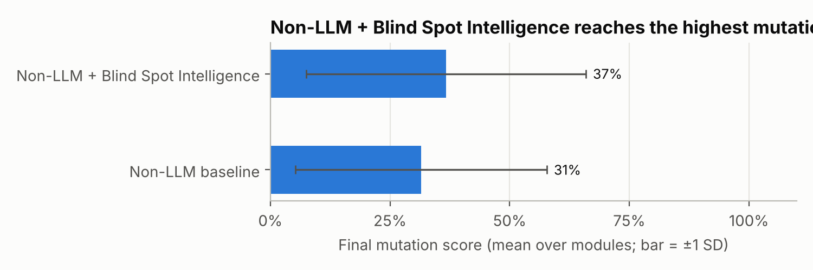
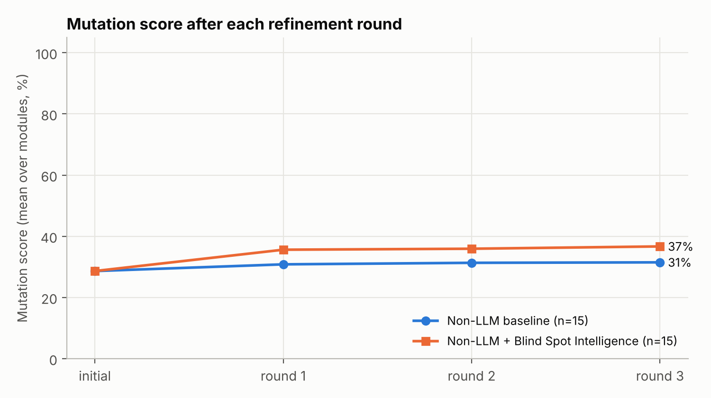
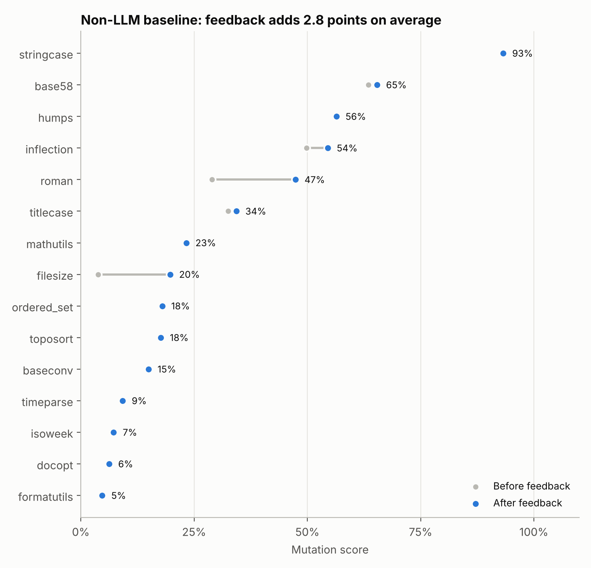
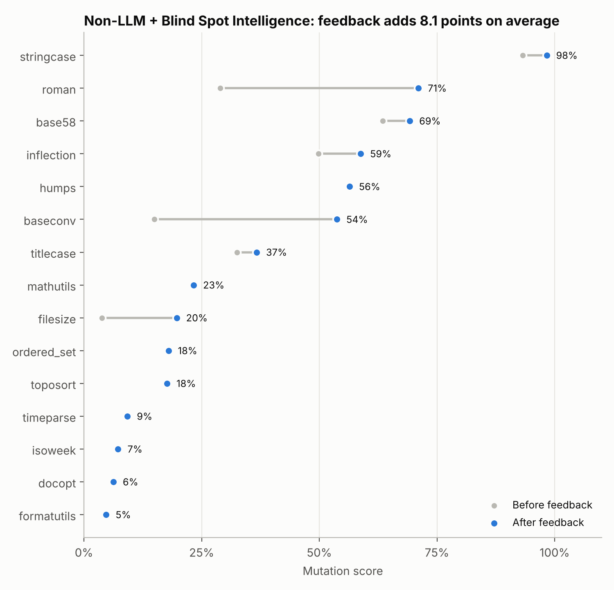
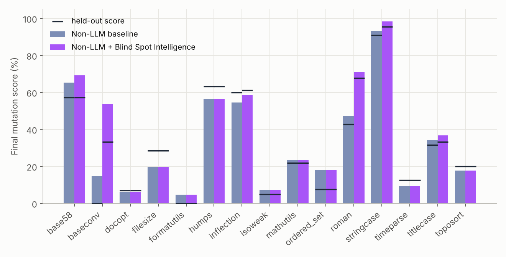

# Results analysis

Source: `results/benchmark_blindspot_mock` · 30 successful runs · 15 modules · 2 configurations

## Summary per configuration

Means over modules (each module first averaged over its repetitions).

| Configuration | Modules | Mutation score | Initial score | Line cov. | Branch cov. | Tests | Cost (USD) |
|---|---|---|---|---|---|---|---|
| Non-LLM baseline | 15 | 31.5% ± 26.3% | 28.6% ± 26.2% | 63.1% ± 22.4% | 42.9% ± 30.9% | 88.20 | 0.00 |
| Non-LLM + Blind Spot Intelligence | 15 | 36.7% ± 29.2% | 28.6% ± 26.2% | 67.0% ± 21.9% | 48.6% ± 32.0% | 91.33 | 0.00 |

**Feedback effect, Non-LLM baseline:** mean gain +2.8 points over 15 modules (Wilcoxon p = 0.0625, A12 = 0.55).

**Feedback effect, Non-LLM + Blind Spot Intelligence:** mean gain +8.1 points over 15 modules (Wilcoxon p = 0.0156, A12 = 0.60).

## Blind Spot Intelligence vs the original pipeline

Same modules, mutation operators, round limit and target; the Blind Spot configuration adds the diagnosis / counterexample / verified-corrective-test agent. *Raw* scores count every mutant the Writer flagged as equivalent as a survivor (LLM judgement is not trusted to shrink the denominator). *Held-out* scores use mutants hidden from every agent (when the sweep ran with `--holdout`).

### Non-LLM + Blind Spot Intelligence vs Non-LLM baseline

| Metric | Non-LLM baseline | Non-LLM + Blind Spot Intelligence |
|---|---|---|
| Initial mutation score | 28.6% | 28.6% |
| Final mutation score | 31.5% | 36.7% |
| Final raw score | 31.5% | 36.7% |
| Held-out score (final) | 29.9% | 34.3% |
| Held-out score (initial) | 26.3% | 26.3% |
| Tests | 88.20 | 91.33 |
| Refinement rounds | 1.47 | 1.60 |
| Input + output tokens | 0.00 | 0.00 |
| Time (s) | 37.24 | 65.52 |
| Cost (USD) | 0.00 | 0.00 |

- Blind spots diagnosed: **354** over 15 modules; verified resolutions: **43** (12% of diagnosed).
- Confirmed diagnoses (measured category + distinguishing input or observed difference): 260 of 354.
- Primary categories: reachability 250, propagation 87, inconclusive 9, infection 8.
- Corrective test validity: 30 of 31 proposed corrective tests passed on the original program (97%).
- Suspected equivalent mutants (no distinguishing input found; reported, not removed): 91.
- Non-LLM baseline: 52 additional mutants killed by refinement; 10.7 s, 0 tokens and $0.0000 per additional killed mutant.
- Non-LLM + Blind Spot Intelligence: 117 additional mutants killed by refinement; 8.4 s, 0 tokens and $0.0000 per additional killed mutant.

| Comparison (paired by module) | Mean difference | p-value | A12 |
|---|---|---|---|
| Final score: Non-LLM + Blind Spot Intelligence vs Non-LLM baseline | +5.2 pts | 0.0312 | 0.56 |
| Raw score: Non-LLM + Blind Spot Intelligence vs Non-LLM baseline | +5.2 pts | 0.0312 | 0.56 |
| Held-out score: Non-LLM + Blind Spot Intelligence vs Non-LLM baseline | +4.4 pts | 0.0625 | 0.56 |

### Diagnosis accuracy

`diagnoses.csv` lists 354 diagnoses. No manual labels yet: fill the `manual_label` column (reachability / infection / propagation / revealability / inconclusive) for a sample and re-run this script to measure agreement.

## Per-module mutation score (final, with initial in brackets)

| Module | Non-LLM baseline | Non-LLM + Blind Spot Intelligence |
|---|---|---|
| base58 | 65% (63%) | 69% (63%) |
| baseconv | 15% (15%) | 54% (15%) |
| docopt | 6% (6%) | 6% (6%) |
| filesize | 20% (4%) | 20% (4%) |
| formatutils | 5% (5%) | 5% (5%) |
| humps | 56% (56%) | 56% (56%) |
| inflection | 54% (50%) | 59% (50%) |
| isoweek | 7% (7%) | 7% (7%) |
| mathutils | 23% (23%) | 23% (23%) |
| ordered_set | 18% (18%) | 18% (18%) |
| roman | 47% (29%) | 71% (29%) |
| stringcase | 93% (93%) | 98% (93%) |
| timeparse | 9% (9%) | 9% (9%) |
| titlecase | 34% (33%) | 37% (33%) |
| toposort | 18% (18%) | 18% (18%) |

## Figures

