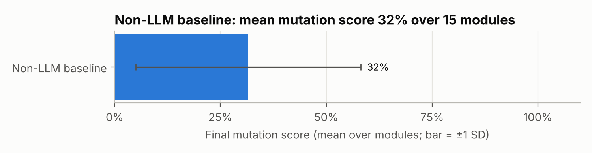
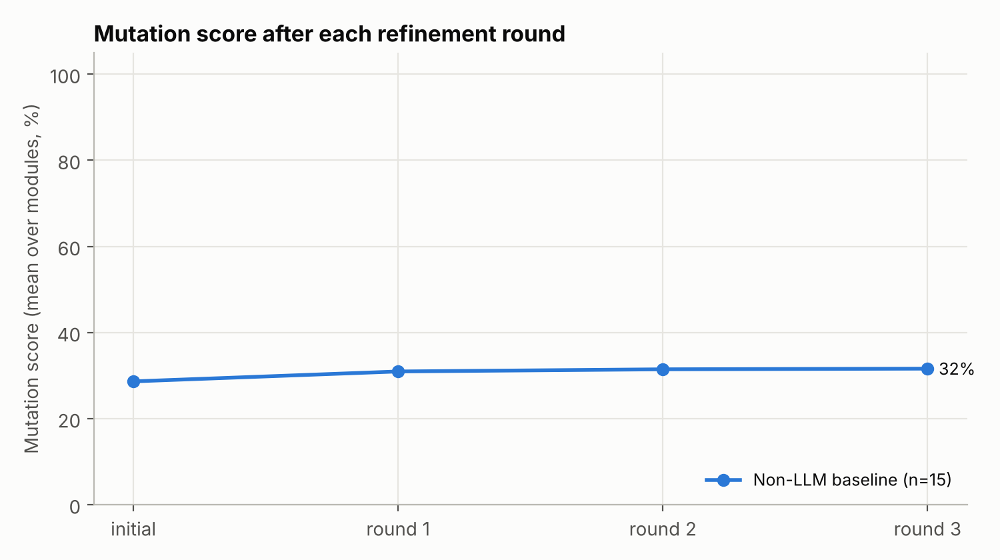
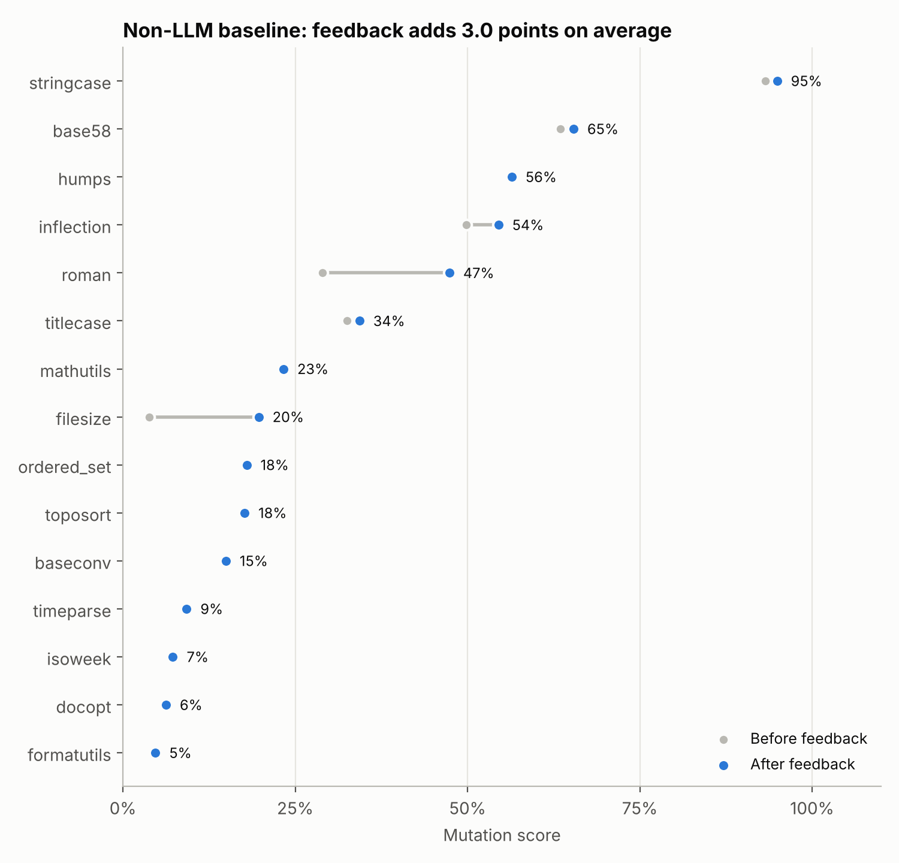

# Results analysis

Source: `results/benchmark_mock` · 15 successful runs · 15 modules · 1 configurations

## Summary per configuration

Means over modules (each module first averaged over its repetitions).

| Configuration | Modules | Mutation score | Initial score | Line cov. | Branch cov. | Tests | Cost (USD) |
|---|---|---|---|---|---|---|---|
| Non-LLM baseline | 15 | 31.6% ± 26.6% | 28.6% ± 26.2% | 63.1% ± 22.4% | 42.9% ± 30.9% | 89.00 | 0.00 |

**Feedback effect, Non-LLM baseline:** mean gain +3.0 points over 15 modules (Wilcoxon p = 0.0312, A12 = 0.55).

## Per-module mutation score (final, with initial in brackets)

| Module | Non-LLM baseline |
|---|---|
| base58 | 65% (63%) |
| baseconv | 15% (15%) |
| docopt | 6% (6%) |
| filesize | 20% (4%) |
| formatutils | 5% (5%) |
| humps | 56% (56%) |
| inflection | 54% (50%) |
| isoweek | 7% (7%) |
| mathutils | 23% (23%) |
| ordered_set | 18% (18%) |
| roman | 47% (29%) |
| stringcase | 95% (93%) |
| timeparse | 9% (9%) |
| titlecase | 34% (33%) |
| toposort | 18% (18%) |

## Figures

